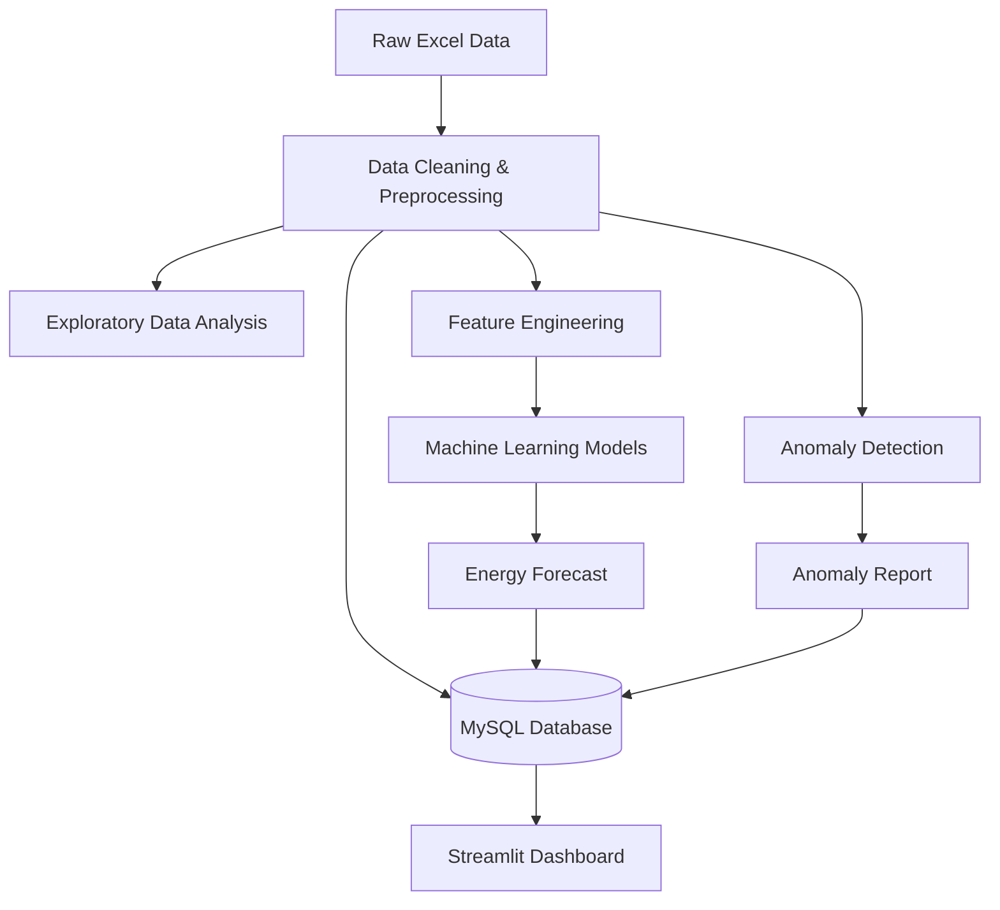
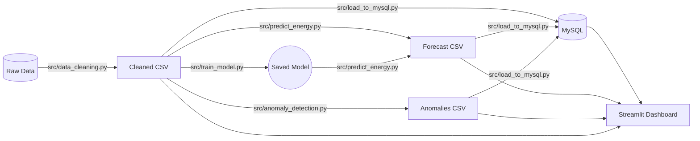

# Predictive Energy Consumption Analytics for Smart Campus Infrastructure

## 1. Project Abstract
This project implements an end-to-end data analytics and machine learning pipeline to analyze, forecast, and optimize energy consumption across a smart campus. By integrating Python-based processing, machine learning models, MySQL database storage, and a Streamlit dashboard, the system identifies consumption patterns, predicts future demand, and detects unusual energy usage anomalies.

## 2. Problem Statement
Educational campuses consume massive amounts of energy across academic blocks, hostels, and specialized infrastructure. Managing this dynamically requires proactive analytics. Without predictive modeling and anomaly detection, campuses suffer from inefficient energy usage and delayed responses to infrastructure faults.

## 3. Objectives
- Consolidate and clean fragmented daily energy logs.
- Predict energy demand for the next 7 days using machine learning.
- Detect unusual spikes or drops in energy consumption.
- Provide a robust MySQL schema for historical tracking.
- Deliver an interactive Streamlit dashboard for campus administrators.

## 4. Existing-System Limitations
Current systems rely on manual Excel reporting or reactive, un-modeled dashboards. They lack forecasting capabilities, do not contextualize energy usage against baseline medians, and cannot automatically separate normal fluctuations from true anomalies.

## 5. Proposed System
The proposed system automates the ingestion, cleaning, and modeling of campus energy data. It uses Scikit-learn for time-series forecasting, an Isolation Forest algorithm for unsupervised anomaly detection, and a unified MySQL database schema. The final output is seamlessly visualized in an interactive Streamlit dashboard.

## 6. System Architecture

## 7. Data-Flow Diagram

## 8. Technologies Used
- **Python 3**: Pandas, NumPy, Scikit-learn
- **Jupyter Notebook**: Exploratory Data Analysis
- **MySQL**: Relational storage (SQLAlchemy)
- **Streamlit & Plotly**: Interactive web dashboard and visualizations

## 9. Dataset Description
The dataset contains daily readings (July to September 2026) for:
- Grid power (HTSC-91, HTSC-178)
- Renewable generation (Solar, Biogas) and Diesel
- Infrastructure consumption (Academic blocks, Hostels, Staff Quarters, Chiller plant, STP)
- Total campus consumption

## 10. Data Cleaning and Preprocessing
Executed by `src/data_cleaning.py`:
- Removed trailing empty rows.
- Parsed `Date` as datetime.
- Coerced text-based missing values (e.g., in `Chiller plant`) to NaN, then linearly interpolated.
- Handled negative values by setting them to 0.

## 11. Machine Learning Methodology
- **Feature Engineering**: Created lag features (1-day, 7-day) and rolling averages (3-day, 7-day) to capture short-term and weekly trends.
- **Models**: Evaluated Linear Regression, Random Forest, and Gradient Boosting against a Naive Baseline.
- **Anomaly Detection**: Used an Isolation Forest model to isolate statistical outliers from the 7-day rolling median baseline.

## 12. Model Evaluation
Evaluated chronologically (last 14 days as test set):
- **Naive Baseline**: MAE ~4742
- **Linear Regression**: MAE ~4058 (Selected as Best Model)
*Limitation*: A 3-month dataset is insufficient for capturing annual seasonality. The model captures short-term local trends.

## 13. Database Schema
Defined in `sql/schema.sql`. Contains 4 normalized tables:
- `energy_readings`
- `energy_forecasts`
- `energy_anomalies`
- `model_metrics`

## 14. Dashboard Development
The interactive dashboard is built using Streamlit. It reads directly from the processed CSV outputs (or the database) and provides 5 main views: Executive Overview, Consumption Analytics, Energy Forecast, Anomaly Detection, and Data Explorer.

## 15. Installation and Execution
1. Install dependencies using uv:
   `uv sync`
2. Run Phase 1 Analysis and Data Cleaning:
   `uv run python src/phase1_analysis.py`
3. Generate and Run EDA Notebook (Phase 2):
   `uv run python src/create_eda.py`
   `uv run jupyter nbconvert --to notebook --execute --inplace notebooks/energy_analysis.ipynb`
4. Train Model and Predict:
   `uv run python src/train_model.py`
   `uv run python src/predict_energy.py`
5. Detect Anomalies:
   `uv run python src/anomaly_detection.py`
6. (Optional) Load to MySQL (configure `.env` first):
   `uv run python src/load_to_mysql.py`
7. Run the Interactive Dashboard:
   `uv run streamlit run app.py`
8. Run Tests:
   `uv run python -m unittest discover -s tests`

## 16. Results and Limitations
- The model successfully predicts 7-day demand with a reasonable margin for the available data volume.
- Anomaly detection flagged 4 statistical outliers.
- **Limitations**: The 3-month dataset lacks winter/summer variations. Future consumption may not reflect short-term historical rolling averages alone.

## 17. Future Enhancements
- Integrate real-time IoT meter readings.
- Expand dataset to multi-year for robust seasonal ARIMA/Prophet modeling.
- Implement automated alerting (e.g., SMS/Email) for anomalies.
"# Predictive-energy-consumption-for-smart-campus-" 
